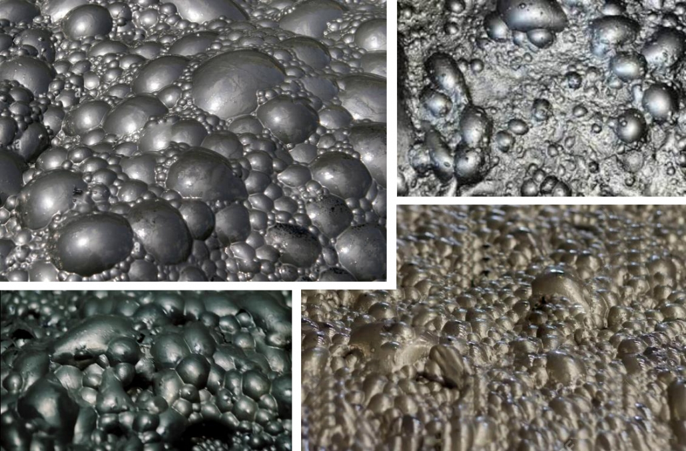

# Froth Flotation Bubbles Segmentation



## Introduction
Froth flotation is an important process in mineral processing, used to separate valuable minerals from unwanted materials. Its efficiency directly affects mineral recovery and concentrate quality.

Monitoring froth bubbles manually can be time-consuming and difficult to scale, especially when continuous observation is required. Automating bubble segmentation can help quantify froth characteristics, reduce manual monitor efforts, and support safer and more consistent process control.

## Overview
This project uses Deep Learning to segment froth bubbles from the background and estimate the Bubble Area Percentage. It focuses on semantic segmentation using Yolo26.

The goal is to build a practical end-to-end application covering data preparation, preprocessing, model training, evaluation, and visualization

## Data Source
The dataset used in this project was provided by Daria Ivanycheva, a student at ITMO University.

The data was accessed in October 2026 and contains images and corresponding segmentation masks.

## Repository
### File System

```
bubbles/
├── data/
│   ├── raw/ # Original dataset
│   └── processed/ # Preprocessed dataset
├── images/ # Saved Matplotlib figures
├── metrics/ # Evaluation metrics
├── models/ # Trained models
├── notebooks/
│   └── Iteration 1/
│       ├── data_collection.ipynb # Data collection process
│       └── data_processing_modeling.ipynb # Data processing and machine learning
├── runs/ # YOLO training and validation runs
├── src/
│   └── bubbles/
│       ├── __init__.py
│       ├── main.py # FastAPI server
│       ├── schemas.py # Pydantic schemas
│       └── train.py # Model training script
├── Dockerfile # Docker configuration for deployment
├── pyproject.toml
└── uv.lock
```

### Installation
There are two types of dependencies: general and development dependencies.

You can use the standard `uv sync` command to install all dependencies. If you only want to run the FastAPI server, you can use `uv sync --no-dev` to skip the dependencies used by the notebooks.

This project uses `uv` 0.12.9 and Python `3.11.16`.

### Deep Learning
There are two notebooks in the `/notebooks/Iteration 1` directory where you can see the detailed process, from collecting data, and preprocessing the data to training and comparing models, and finally evaluating and selecting a model.

### Links

You can use the web app, it provides bubble segmentation and Bubble Area Percentage estimation through image uploads and real-time video frame processing.

Web App: https://bubbles.olver.site/map

You can also use the API directly or view its documentation.

API Docs: https://api.bubbles.olver.site/docs

You can also view the web application repository on GitHub: https://github.com/OlverArceL01/Bubbles-app
